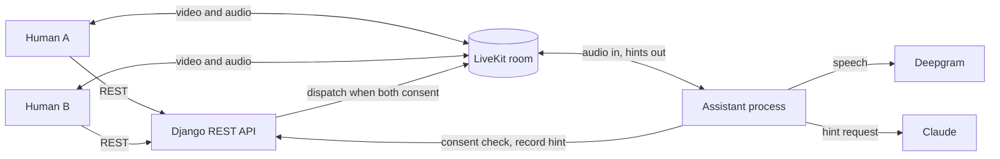

# Presence

[](https://github.com/mikhail-vashchuk/presence/actions/workflows/ci.yml)

**A Django backend for a private two-person meeting, with an optional quiet AI assistant that joins only if both people agree.**

Two people meet through a short invitation and a short reply. Once the invitation's author accepts, they get a private video room. If both of them consent, a quiet assistant joins the room, listens, and now and then offers a single question when the conversation stalls. It never records the conversation.

Presence is a learning project: I built it to practise backend design and to put an LLM into a real-time product responsibly, pair-programming with Claude Code along the way. It has no frontend. The API contract for a client is documented in [`docs/architecture.md`](docs/architecture.md).

## Demo

`scripts/demo_moment.py` plays a Moment between two simulated people who speak scripted lines through speech synthesis. The assistant joins the room, hears them, and sends a hint when they fall silent. This is real output:

```text
Moment #4 started between two demo people.
Joining the room as both people...
Both people agree to the quiet assistant...
The assistant is in the room. The conversation begins:
  A: Hi! I saw your reply. I keep starting side projects and then abandoning them, and I want to understand why.
  B: Same here, honestly. I dropped my third one just last week.
  A: What usually makes you stop? For me it is the moment the fun part is over and the boring work begins.
  B: Yes, exactly. The boring part feels like a completely different job.
Now it is quiet. Waiting up to 90 seconds for a hint...

Hint received: {"hint_id": 1, "text": "Is the boring part really a different job, or does it just lack the novelty that got you started?"}

Recorded in the database as a 'silence' hint.
B pressed "not now"; the assistant will wait twice as long.
```

The hint is written from what was actually said, not from the topic alone. When one person does most of the talking instead (`--scenario balance`), the assistant asks a question that is open to both people and does not single anyone out.

See [Trying the assistant](#trying-the-assistant) to run it yourself.

## What is interesting about it

- **Consent is a domain rule, not a setting.** Each participant's consent is stored on their own `Presence`, can be withdrawn at any time, and the assistant is active only while both are set. It is presented as an offer: a person never learns whether the other declined.
- **It fails closed.** The assistant asks the backend whether consent still stands every few seconds, leaves as soon as the answer is no, and also leaves if the backend cannot be reached several times in a row.
- **Private by design.** Audio goes to a speech-to-text provider and is discarded, with the provider's model-improvement program opted out. Recognised text lives only in memory for the duration of the Moment. The database keeps metadata only: when a hint was offered, its kind, whether it was dismissed, and an optional rating. Hint text is never stored.
- **Quiet by design.** A hint is allowed only after a long pause or a long one-sided stretch, never in the first seconds, and never more often than a cooldown that doubles every time someone presses "not now".
- **The model sees participant text as data.** Everything the participants wrote or said reaches the prompt escaped and inside tags, and the system prompt tells the model to ignore instructions found there.
- **A clear boundary.** The assistant is a separate process built on [LiveKit Agents](https://docs.livekit.io/agents/). It shares no code or database with Django and talks to it only through two internal endpoints protected by a service token. Claude is called through the official SDK, handles refusals, and the model is configurable.
- **Business rules in services, invariants in the database.** Views only translate HTTP; services decide what is allowed and run state changes in transactions with row locks; rules that describe impossible states are also database constraints. See [`docs/architecture.md`](docs/architecture.md).
- **Tested end to end.** Service, API and assistant tests run on every push against PostgreSQL in GitHub Actions.

## How it works



```text
both Humans consent
    ↓
Django asks LiveKit to dispatch the assistant to the room
    ↓
the assistant joins, listens, and re-checks consent every few seconds
    ↓
after a pause, it asks Claude for one short hint, records it in Django,
and sends it to the room
```

## The meeting itself

A Human creates an Invitation with a short message. Another Human can respond to an open Invitation, and the Invitation's author can accept or reject that Response. When a Response is accepted, a Moment begins and both participants can enter its private video room. Each Human taking part in a Moment is represented by a Presence, and either participant can later complete the Moment.

```text
Invitation → Response → Acceptance → Moment
```

Before a Moment begins, one Human's identity is not exposed to the other: an Invitation carries only its author's short message, and a Response only the responder's words.

### Domain rules

- A Human can have only one open Invitation.
- A Human can have only one pending Response.
- A Human cannot respond to their own Invitation.
- A Human in an active Moment cannot create an Invitation or send a Response.
- Only the author of an Invitation can accept or reject its Responses.
- Only participants of a Moment can access its video room.
- Public Invitations are unavailable while a Human is in an active Moment.

### Scope

Presence is limited to this meeting flow. It does not define discovery or ranking systems, a social graph, persistent messaging, detailed profiles, or a wider social application around the meeting.

## Project structure

Presence is built with Django and Django REST Framework and is divided into three applications, plus the assistant.

| Part | Responsibility |
| --- | --- |
| `accounts` | Authentication and email verification; the `User` model |
| `humans` | The `Human` model: a `User` is an authenticated account, a `Human` is the person taking part in the meeting |
| `presence` | The meeting logic: `Invitation`, `Response`, `Moment`, `Presence`, plus the assistant's consent, hints and feedback |
| `assistant` | The separate assistant process: conversation memory, the policy for when to speak, Claude calls, and the LiveKit agent |
| `scripts` | Development tools, such as the demo above |

## Running the project

You need Python (see `.python-version`), Docker for PostgreSQL, and a [LiveKit](https://livekit.io/) project for the video rooms.

```bash
pip install -r requirements.txt
cp .env.example .env        # then fill it in
docker compose up -d db
python manage.py migrate
python manage.py runserver
python manage.py test
```

`.env` is git-ignored; `.env.example` lists every variable.

## Trying the assistant

The assistant is a separate process with its own dependencies.

```bash
pip install -r assistant/requirements.txt
```

Add these to `.env`:

- `ASSISTANT_SERVICE_TOKEN`: a random secret shared by Django and the assistant. Generate one with `python -c "import secrets; print(secrets.token_urlsafe(32))"`.
- `ANTHROPIC_API_KEY`: from the [Anthropic Console](https://console.anthropic.com/).
- `DEEPGRAM_API_KEY`: from the [Deepgram Console](https://console.deepgram.com/).
- `ASSISTANT_MODEL`: optional. `claude-haiku-5-5` is the cheapest choice and is enough for short, rare hints.

Then run three processes. The demo thresholds make the assistant speak after seconds instead of minutes.

```bash
python manage.py runserver
```

```bash
ASSISTANT_POLL_INTERVAL=1 ASSISTANT_STARTUP_GRACE=5 ASSISTANT_SILENCE_AFTER=10 ASSISTANT_BALANCE_MIN_SPEECH=40 python -m assistant.agent dev
```

```bash
python -m scripts.demo_moment                      # the conversation falls silent
python -m scripts.demo_moment --scenario balance   # one person does all the talking
```

The demo writes to the development database and completes the Moment when it finishes.

If a request to LiveKit fails with `CERTIFICATE_VERIFY_FAILED` on macOS with a python.org Python, run the `Install Certificates.command` that comes with that Python.

## Documentation

The architectural decisions, the assistant's design, and the client contract are described in [`docs/architecture.md`](docs/architecture.md).
